# Submit bids through a cascading wholesale market integration in the local power market (Matlab code implementation)

Submitting bids in the local power market through a cascaded wholesale market integration (Matlab code implementation)
\n        \n      ​  
📚2 Running results
​ ​  
​  
Editor
Editor
Editor
Editor
Part of the code:
%% Load Data base  
noRuns=20;  
​  

## Images

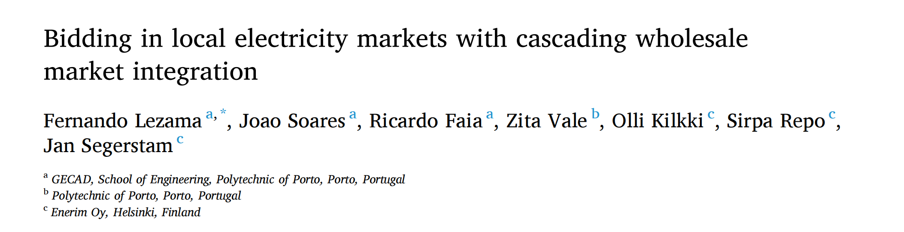
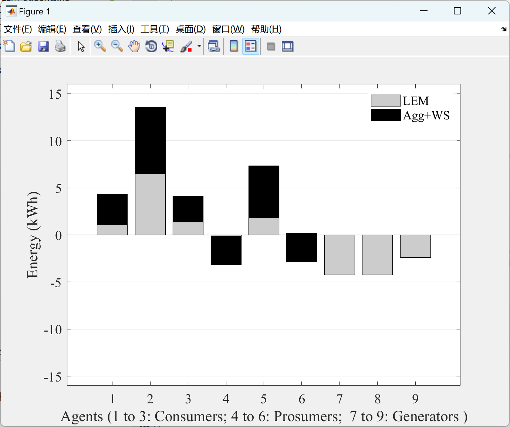
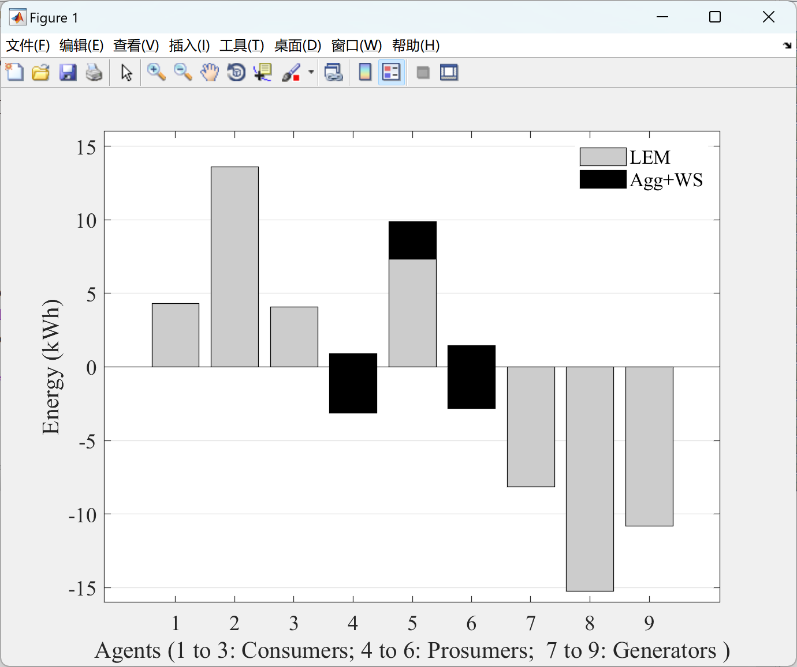
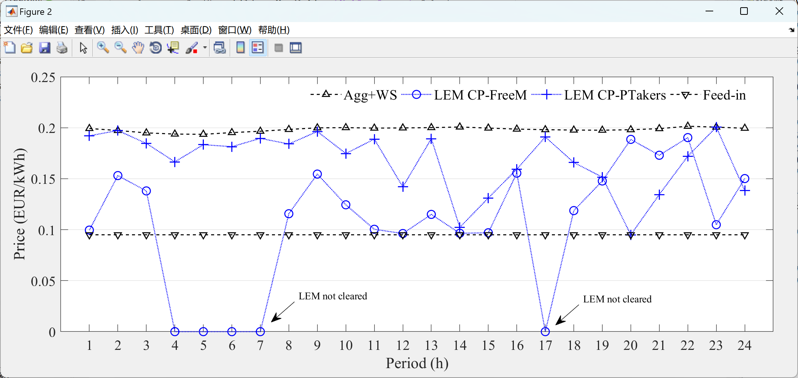
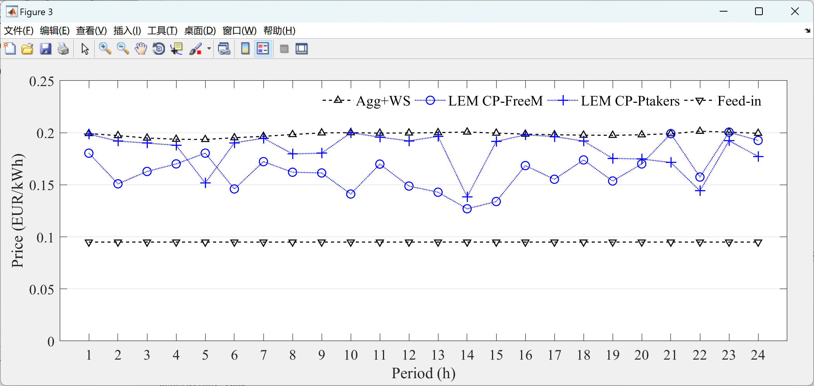
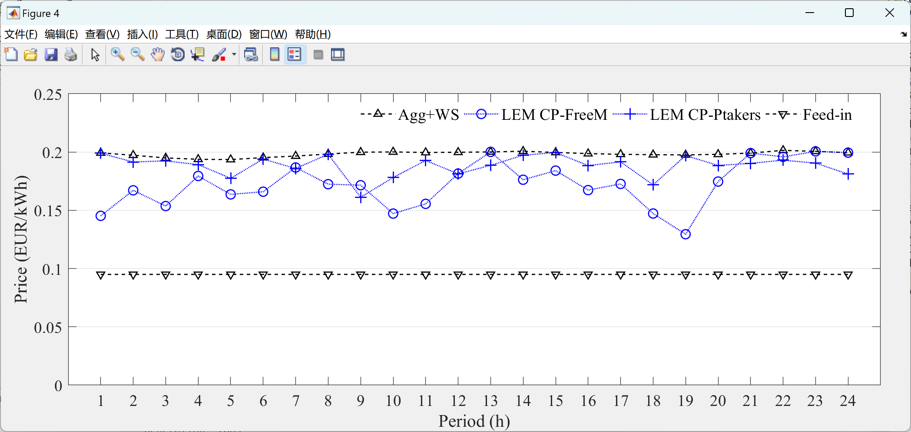
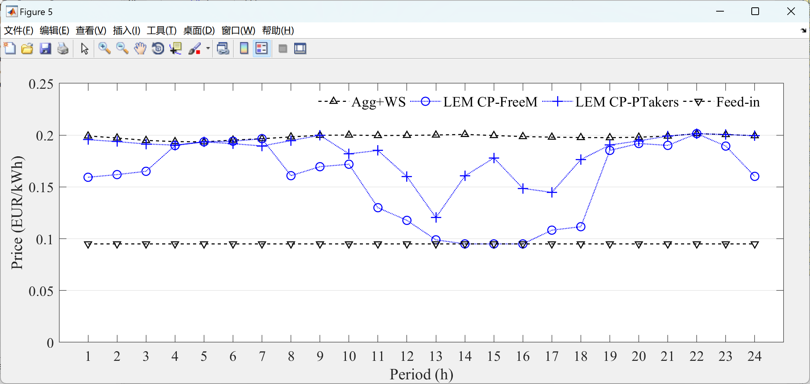
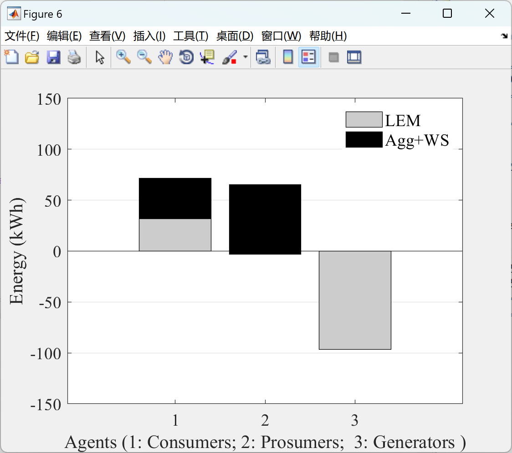
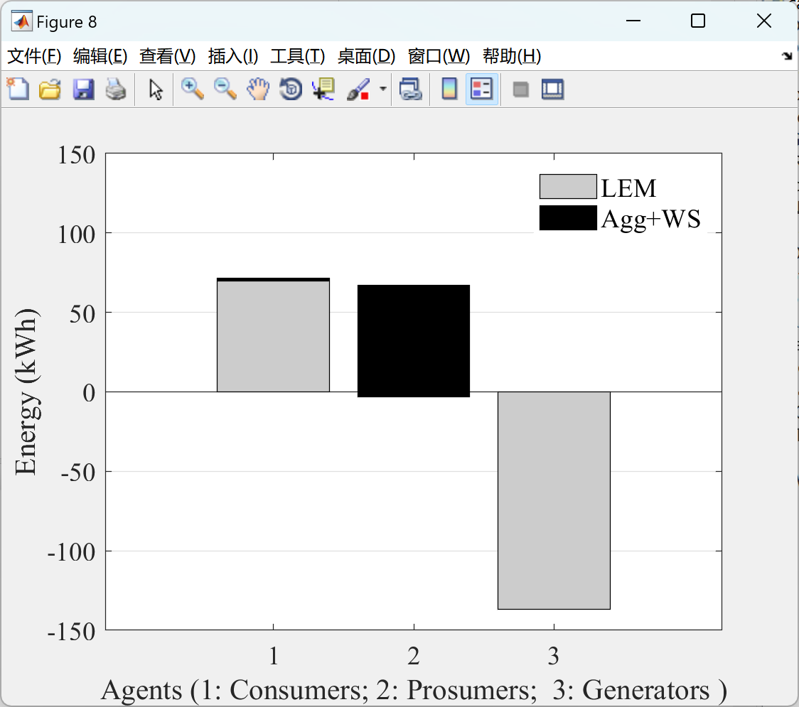
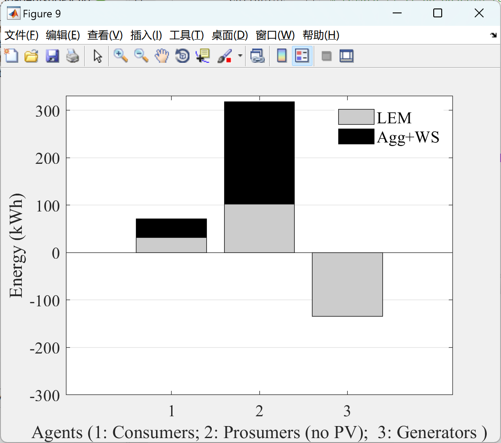
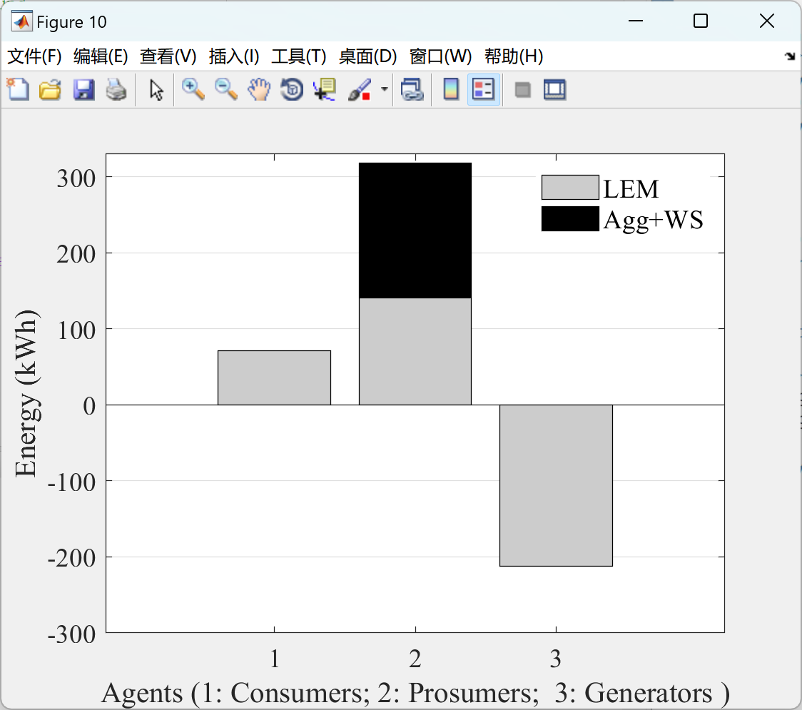

<!-- PAYMENT_BLOCK -->

## Get this dataset

- Payment link (Stripe): [Buy now](https://buy.stripe.com/3cs8yP7sY87d0vu9AB)
- Payment QR code: 

<!-- /PAYMENT_BLOCK -->
